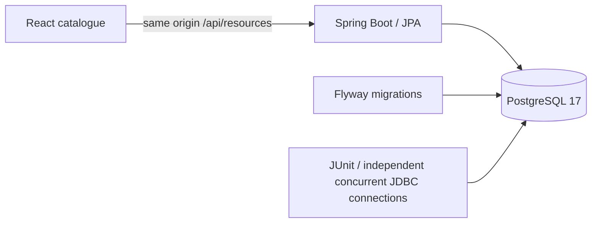

# SlotSync foundation runbook

## Architecture and boundaries



The frontend is compiled into the application JAR during the Docker build. The
catalogue endpoint returns active resources ordered by stable code, without
account fields. The catalogue itself is read-only. Static/catalogue/health/session
GETs are public, including the current policy. Requester booking writes require
a session, role/ownership checks and CSRF. Approver/admin routes have separate
roles and live database account checks. Unimplemented routes stay closed. See
[the booking API guide](BOOKING_API.md) and [admin workflows](ADMIN_WORKFLOWS.md).

V1 creates resource types, resources, users and bookings. No passwords are
committed. V2 adds only synthetic campus resources. V3 adds actor-scoped
replay responses and audit events. V4 adds prospective policy versions, import
batches and admin audit events without modifying V1–V3. Optional demo accounts are seeded
with BCrypt hashes when the Docker configuration enables them. JPA
validates its mapped schema rather than creating tables. Flyway history owns
migration versions; never edit an applied migration once published.

The `btree_gist` extension lets PostgreSQL combine resource UUID equality and
`tstzrange(starts_at, ends_at, '[)')` overlap in one exclusion constraint. PENDING
and APPROVED block time; CANCELLED and REJECTED do not. Endpoints are finite,
non-null and strictly ordered. Timezone offsets represent instants, so changing
an offset cannot avoid a conflict. This is a database invariant, not a claim of
measured throughput. The requester endpoints use the same invariant.

Raw simultaneous GiST inserts may abort one transaction with overlap SQLSTATE
`23P01` or deadlock `40P01`. The race test permits only those failures and requires
exactly one committed row. The booking service serializes per-resource writes,
retries a deadlocked transaction up to three times, and translates overlaps to
HTTP 409. Injected SQLSTATE tests verify retry success and exhausted rollback.
See [PostgreSQL transaction retry guidance](https://www.postgresql.org/docs/17/mvcc-serialization-failure-handling.html).

## Start, stop and restart

From the repository root:

```sh
python scripts/init_demo.py
docker compose up --build --wait --wait-timeout 180
curl -f http://localhost:8080/actuator/health/readiness
curl -f http://localhost:8080/api/resources
docker compose down
docker compose up --wait --wait-timeout 180
```

The generator retains an existing secret. The named `database` volume retains
PostgreSQL data when stopped. Do not regenerate a secret while keeping its old
database volume: PostgreSQL's initialization password applies only to an empty
volume. Docker Compose `down` without `--volumes` preserves that data.

On Linux/macOS the generator enforces a private `0700` `.secrets` directory and
a read-only `0444` secret file. Compose file secrets are bind mounts, so the
file must be readable by the app container's different non-root UID. The private
parent directory blocks access by other host users; it is not mounted into the
container. Do not copy the secret file to a shared directory. Windows uses the
workspace's inherited access controls. Re-run the generator after upgrading an
earlier foundation checkout to fix Linux permissions without changing the secret.

For a deliberately disposable fresh demo, use a **new Compose project name**
(for example `docker compose -p slotsync-fresh up --build --wait`). This creates
an independent database volume without deleting the original. Stop the first
demo or select another loopback port with `SLOTSYNC_HTTP_PORT`. Do not expose
this incomplete local preview as a public service.

## Verification

`./mvnw verify` uses an ephemeral Testcontainers PostgreSQL 17 instance. Missing
Docker is a failure. `compose.test.yml` provides an alternative for a host with
no JDK: Maven and an ephemeral test database share an isolated Compose network.
The external test URL override is restricted to a database named `slotsync_test`;
never point tests at an application/user database. Tests clear their test
bookings/users between cases. There is no PostgreSQL host port in either setup.

The suite verifies migration reruns, active-only deterministic API results,
closed writes, health detail redaction, pending/approved overlaps, adjacent slots,
different resources, inactive statuses, cancellation/reactivation, equivalent
timezones, invalid intervals and a real two-connection race. Use `verify`, not
only Maven `test`: the `*IT` suite runs in Failsafe's integration-test phase.

Frontend tests exercise loading, filtering, empty data, failed HTTP/retry and
request abort. Playwright uses the real API and saves desktop/mobile screenshots
under ignored `frontend/test-results/`; CI uploads these and JUnit reports.

## Development

Use Java 21, Node 24.14+ and the checked-in Maven/npm locks. Maven 3.9.11 is pinned
by the wrapper. For frontend development, run `npm ci && npm run dev` in
`frontend`; Vite binds loopback and proxies `/api` to `localhost:8080`. Stop that
server when returning to the Docker-served build, which remains at port 8080.
Update the production build with `docker compose up --build --wait`.

## Failure diagnosis

```sh
docker compose ps
docker compose logs --no-color --tail 100 app db
```

Readiness includes the database: when PostgreSQL is unavailable the readiness
endpoint returns 503 after the connection check timeout, rather than reporting
the catalogue as healthy. Details are hidden from HTTP responses. If the app
cannot start, inspect the local logs for migration/password errors. A port
collision can be resolved by choosing a different `SLOTSYNC_HTTP_PORT`.

If the catalogue API fails, React shows an error with a retry action. No mock
resources are substituted. A database outage, empty catalogue or a filtered
result must never be presented as availability for a booking.
